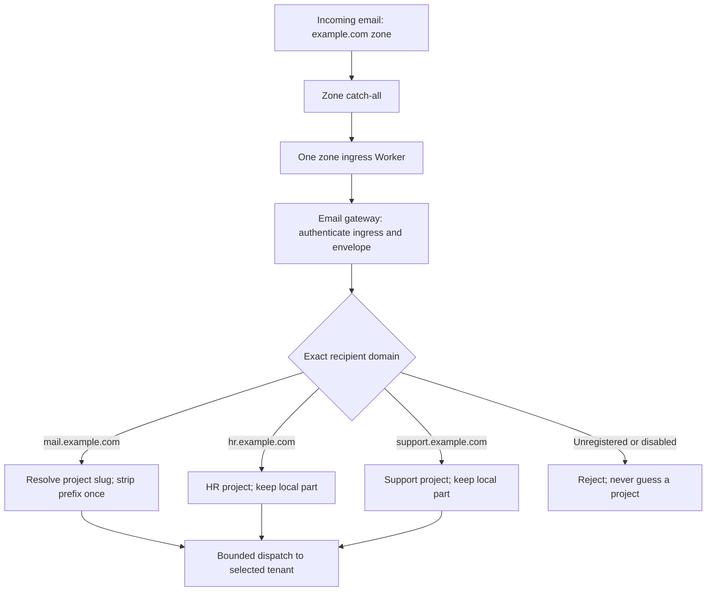
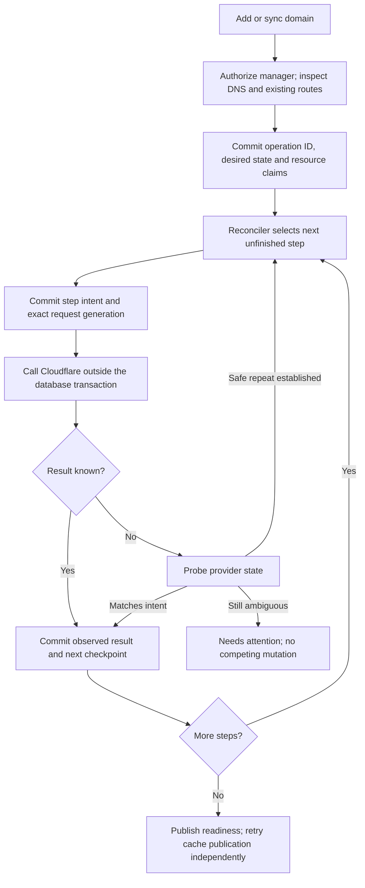
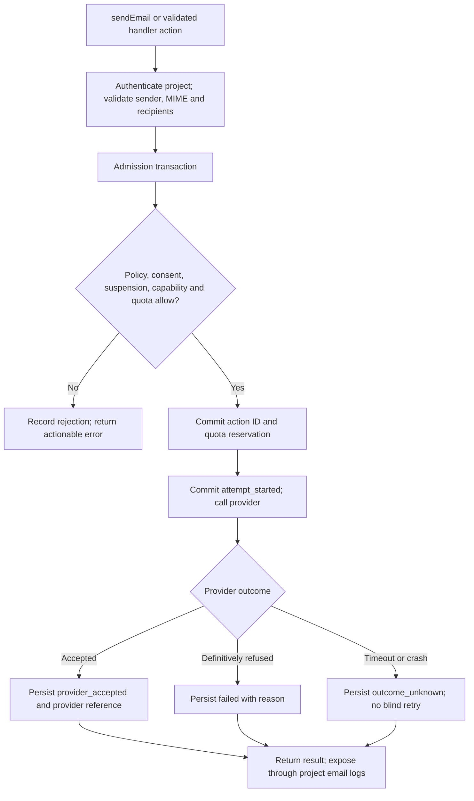
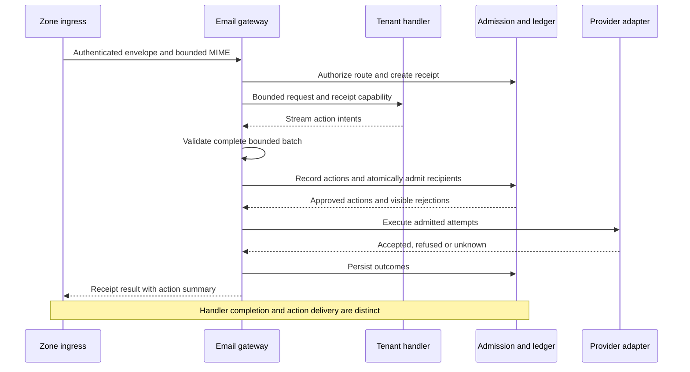

# Cloudflare-native email design

Email has not been released to production. This document defines the target
for the first production release, including routing, setup, credential lifecycle,
delivery policy and observable outcomes. The implementation already provides the
`void/email` programming model; the remaining architecture and verification work
below must be completed before release.

The [email guide](../../../docs/guide/email.md) and
[administration guide](../../../docs/guide/platform-administration.md#managing-email)
will be aligned with the completed implementation. The control-flow diagrams in
this document describe the intended behavior, not a claim that every path is
already implemented.

## Decisions

| Concern           | Design decision                                                                  |
| ----------------- | -------------------------------------------------------------------------------- |
| Routing ownership | One zone ingress, many explicitly registered mail domains                        |
| Company setup     | Shared sender and project subdomains share the zone ingress                      |
| Provisioning      | Durable operation steps, provider read-back and resumable reconciliation         |
| Credentials       | Scoped API token by default; operator credential for administrator-managed zones |
| Tenant response   | Byte-bounded HTTP response with a constrained action format                      |
| Admission         | Authoritative policy, suspension and quota reservation in PostgreSQL             |
| Outcomes          | Durable, queryable action outcomes, including uncertainty                        |
| Readiness         | Separate inbound, outbound and management readiness                              |

The platform already depends on PostgreSQL. Use that authority for the first
version instead of adding another state store. This adds latency and makes email
admission depend on database availability; it is an explicit correctness tradeoff.
Measure the cost before considering another serialized admission service.

## Hosting boundaries

- **Managed and self-hosted platforms:** tenant Workers get only the authenticated
  proxy interface. Platform services own credentials, delivery policy, quota
  accounting and provider calls. Both installations use this design.
- **Native Cloudflare deployments:** the app keeps its own send binding and native
  email event. No platform database, admission service, relay or outcome ledger is
  required. Keep the existing setup preflight, ownership checks and local inbox.
- **Development:** capture remains local and authenticated with the dev-trigger
  token. `sendInDev` does not create a production transport.

Native deployments remain Workers Free-compatible for routing and verified
recipients. Arbitrary-recipient sending is an explicit Email Sending capability
requiring Workers Paid on the sending account. Probe entitlement only when that
capability is requested, before provisioning it; name the plan, enablement link
and permissions in the error. An app without email gets no email binding or probe.
These distinctions follow [Cloudflare's current pricing](https://developers.cloudflare.com/email-service/platform/pricing/).

## Native Cloudflare setup

Native setup lives in
[email-cloudflare.ts](../../../packages/void/src/cli/email-cloudflare.ts).
`void deploy --platform cloudflare` and `void email setup|status` share its
read-only preflight and selected Wrangler session. The developer supplies
`email.from`; Void never chooses a mail domain.

### One keystroke

Interactive deployment shows the selected account, the domain and the
unfinished account changes before offering setup. Non-interactive deployment
reports unfinished setup and deploys without email; `--require-email` makes
setup a prerequisite. Ready configuration is reconciled without repeating
account mutations.

The checklist separates account work, config updates and routing rules.
`wrangler deploy` owns rule application; a pending rule is not a reason to
rerun account onboarding. A refused Sending onboarding is retried only by an
explicit `void email setup`.

### The flow, by lane

1. Read domain DNS, account identity, routing settings, existing rules and
   Sending state before applying anything.
2. Enable routing only where needed; leave apex mail records alone when the
   sender uses a subdomain.
3. Enable the zone's `support_subaddress` setting when needed; a literal
   address rule alone does not deliver `support+tag@`.
4. Attempt Sending onboarding only when arbitrary-recipient sending is
   requested; report plan or permission refusals without touching unrelated records.
5. Reconcile the owned sender and binding configuration. Write `addresses`
   only when inbound routing is ready, then let pinned Wrangler apply it.
6. Print the inbound map and the remaining manual steps.

### Credentials

Use pinned Wrangler commands wherever one exists. For zone classification,
subdomain routing and subaddressing — calls with no Wrangler command — borrow
the session bearer through `wrangler auth token --json` inside the narrow
request closure. Never persist, log, include in errors or forward it to
another origin; disable Wrangler disk logging on the handoff. Credentialed
preflight runs before any project code is evaluated.

The session gate checks the required email scopes on OAuth sessions. API-token
permissions are established by the actual reads. A Global API Key is refused
where the bridge needs a bearer. Prose parsers are pinned to the bundled
Wrangler version and tested against its captured output; a parser miss yields
unknown state and setup guidance, never permission to write.

### The `addresses` array

Void owns the whole derived top-level `addresses` array. Hand-written entries
it cannot derive skip setup without changing the array. Addresses already
routed elsewhere are pruned from the plan. When routing is unready the key is
deleted, never written as `[]` — that would ask Wrangler to delete every owned
rule. The root config is re-read after edits and the deployment verifier's
whole-array check is preserved.

### Error map and degraded branches

Known provider errors are classified for routing-not-enabled,
already-onboarded and Sending-entitlement refusals. Unknown failures stay
diagnosable and never authorize retrying an uncertain write.

A refused subdomain-routing or subaddressing call prints the explicit
Cloudflare dashboard step and withholds `addresses` for that run. Setup is
never reported complete merely because the Worker uploaded. Sender config and
an inert send binding remain useful for verified destinations when
arbitrary-recipient Sending is unavailable.

### Unverified against live Cloudflare

Unit tests are not provider acceptance. Still to establish with the selected
credential type, per the [live release procedure](../release-acceptance.md):
the subdomain routing POST and subaddressing PATCH, rule-plan permissions,
conflict behavior after dashboard edits or Worker renames, and multi-label
mail subdomains.

## Zone ownership and project routing

### One zone ingress

A zone owns its catch-all rule and ingress Worker. A project owns an exact mail
domain. Several project domains may reference the same zone ingress. The
installation's shared mail domain is a reserved route in that same map.

For example, `hr+alerts@mail.example.com` uses shared addressing, while
`alerts@hr.example.com` uses the HR project's custom domain. Registering
`support.example.com` changes the route map, not the catch-all target. Keep one
project per custom domain; a project may own several domains. The constraint
being removed is one live mail domain per zone, not domain-to-project exclusivity.

The ingress streams the original MIME and exact SMTP envelope recipient over
HTTPS to the gateway. Routing never uses the MIME `To` or `Cc` fields, which do
not identify BCC recipients. Shared addressing strips the slug prefix exactly
once; custom-domain addressing preserves the local part. Existing route
precedence, case-insensitive matching and case-preserving captures remain.

Unknown domains are rejected. Existing explicit Cloudflare rules may take
precedence over the catch-all: setup must enumerate them and report conflicting
addresses before claiming that an entire domain is routed to Void. An unrelated
enabled catch-all is a setup conflict. No automatic takeover or fallback to the
first registered project is permitted.

### Trust and management scope

An ingress credential authenticates one `(installation, account, zone, ingress)`
identity, not a caller-supplied project ID. The gateway verifies that the exact
recipient domain is active on that ingress and resolves its project from the
authoritative route map. A secret for one zone cannot inject into another zone.
The relay knows no provider credential. Its secret can inject inbound traffic
for registered domains in its zone; the zone administrator already controls mail
routing for those domains. This wider scope must be explicit in the design.

Separate `managed_by` on a **zone connection** from `managed_by` on a **domain
assignment**. Creating the connection requires authority over the Cloudflare
zone. A project owner who can remove their assignment cannot redeploy the shared
Worker, rotate its credential, detach the catch-all or affect sibling domains.
Adding another assignment to an existing connection requires its manager's
approval or an existing authorization from that manager; matching a domain
suffix is not proof of authority. Multiple independent owners on one zone must
use the same administrator-approved connection.

Administrator-managed connections use the operator credential only when the
zone account equals `CF_ACCOUNT_ID`. Owner-managed connections retain a scoped
credential in the platform's secret store. Shared resources must not be encrypted
under a project key that disappears when the first project is deleted; use a
connection-scoped envelope key and associated data. Moving an existing credential
requires an explicit, audited operation, never a silent ownership transfer.

### Data model

| Record                   | Identity and responsibility                                                                                                                 |
| ------------------------ | ------------------------------------------------------------------------------------------------------------------------------------------- |
| `email_zone_connections` | Unique account + zone within an installation; manager, credential reference, stable ingress name, deployment version and secret generations |
| `email_domain_routes`    | Globally unique normalized exact domain; connection, custom project or shared-addressing mode, desired state and observed capabilities      |
| `email_credentials`      | Manager, resource scope, encrypted token or platform reference, credential generation and health; no secret in route caches                 |
| `email_operations`       | Idempotency key, actor, resource, desired generation, durable step states and sanitized failure details                                     |
| `email_actions`          | Project, receipt or send ID, action ID, payload digest, recipient outcomes, quota debit and provider references                             |
| `email_quota_buckets`    | Project and time window; atomic recipient-attempt usage                                                                                     |
| `email_cache_outbox`     | Committed route/settings versions awaiting KV publication                                                                                   |

Replace the existing one-live-domain-per-zone index only after all readers and
writers understand the connection relationship. Keep exact-domain uniqueness
and unique ingress name per account. Reserve shared mail domains so they cannot
also become custom project domains. A domain transfer first disables the old
assignment and drains its admitted work; a stale routing hint never authorizes
a delivery to the new or old project.

## Recoverable provisioning

### Setup control flow

The owner CLI and administrator CLI call the same operation service. Authorization
differs; lifecycle and recovery do not. The existing owner/admin restrictions and
installation-wide `self-serve` / `admin` mode remain enforced server-side.

Persist an operation before any provider mutation. Return its ID even while work
is pending; replaying the same idempotency key and request returns that operation.
Reusing a key with different intent is a conflict. The CLI resumes by ID after a
lost response rather than inferring success or revoking a credential from a short
series of missing reads.

A scheduled reconciler resumes committed work; queue notifications may reduce
latency but are not the only way to discover unfinished operations. Each provider
step has an intent, request digest, resource identity, attempt number and outcome
(`pending`, `in_flight`, `confirmed`, `blocked`, `unknown`). `blocked` includes a
specific human action, such as granting a permission or enabling Sending.

Use short database transactions to claim work and commit results. Do not hold a
project or domain row lock across provider calls. Serialize mutations of a zone
connection, including removal, and fence database updates by operation generation.
Cloudflare does not honor that fence: an expired execution lease alone is not
permission to start a conflicting provider write. After a timeout, establish the
outcome or stop for operator recovery. Repeat only an operation demonstrated to
be idempotent with the same stored payload. A late response cannot overwrite a
newer database generation.

Setup proceeds through:

1. Resolve the exact account and zone, check grant scope, inspect existing MX and
   routing rules, and reserve the connection/domain assignment.
2. Enable only the requested routing domain. Preserve existing apex MX; select a
   mail subdomain when necessary. Attempt the supported API, or report a precise
   dashboard action if that credential/provider combination cannot complete it.
3. Deploy or reuse the zone ingress, provision its authenticated connection, and
   confirm that the gateway accepts that identity before changing traffic.
4. Reconcile the owned catch-all. Report conflicting explicit rules and foreign
   catch-all ownership; do not overwrite them.
5. Confirm inbound readiness. Onboard Sending separately when requested and
   permitted; its failure does not erase functioning inbound routing.
6. Commit observed capabilities and an outbox entry. Cache failures leave the
   operation committed and publication pending; they never undo provider progress.

The first release may still need manual provider steps. It must show exactly what
is ready and what remains; successful Worker upload is not proof of mail flow.

### Credentials and refresh

For new owner connections, default to an API token limited to the selected zone
and account. Show the actual resource scope and required permissions before
accepting it. A template whose defaults cover all accounts/zones is not sufficient
proof of narrow scope. Verify operations with the selected token and retain manual
creation instructions when the dashboard template cannot express the scope.
`Workers Scripts: Write` remains account-wide; disclose that residual breadth.
Never describe the token as confined to one Worker.

Do not use Wrangler's public OAuth client for the production credential flow.
A future Void-owned or explicitly supported OAuth integration requires a validated
consent screen, resource scope, refresh lifecycle and revocation flow. Experimental
grants in development environments can be explicitly replaced with scoped tokens;
there is no production OAuth compatibility requirement.

Any rotating OAuth credentials retained for testing or supported in the future
must follow these rules:

- Serialize by credential/grant identity, not by the domain using it. Commit
  `refresh_started` before sending the refresh request.
- Commit the returned refresh token and incremented generation in a standalone
  credential transaction before releasing the access token to any caller.
  Provisioning and KV publication cannot roll that transaction back.
- A process crash or lost response can still consume the old token without
  preserving its replacement. Record `refresh_unknown`, stop automatic refresh,
  and request reauthorization unless the provider offers a documented recovery
  mechanism. A database transaction cannot make token rotation atomic at Cloudflare.
- Replacement and revocation use the same serializer. Revoke a superseded grant
  only after the new credential is committed and no connection still references it.

The credential broker decrypts credentials and gives bounded leases only to the
trusted provider adapter, never tenants or ingress Workers. Check credential
revocation and domain authorization at each admission, even if the adapter still
holds a previously issued lease. Requests already submitted to Cloudflare cannot
be recalled. Operational credential failure pauses sending/management; it does
not automatically revoke independently authenticated inbound routing. An explicit
security revocation can disable both capabilities and the ingress identity.

### Relay secret rotation

Secret rotation is its own durable operation, not a side effect of every `status`
or `sync`. Store the new generation encrypted and register its accepted hash in
the authoritative gateway state before deploying it to the ingress. Keep the
previous generation accepted while the provider write is unconfirmed.

A successful controlled ingress probe confirms the deployed generation. Then
commit the new active generation and a bounded overlap deadline for old in-flight
requests. Retire the old generation after that deadline. If deployment fails,
keep the old active generation and report the pending rotation. Reuse the same
staged secret on retry. A compromise-triggered rotation revokes the old generation
immediately and reports the possible interruption instead of promising continuity.
Neither route-cache lag nor a failed KV write can roll back the active secret.

### Readiness and removal

Expose three independent states with reasons and observation times:

| Capability            | Example states                                                     |
| --------------------- | ------------------------------------------------------------------ |
| Inbound               | `pending`, `ready`, `disabled`, `drifted`                          |
| Outbound              | `pending`, `verified_only`, `ready`, `blocked`                     |
| Management credential | `healthy`, `expired`, `revoked`, `refresh_unknown`, `probe_failed` |

`status` performs provider reads and may save observed state or repair a cache; it
never changes provider configuration. `sync` requests reconciliation. Distinguish
these operations instead of describing a database-updating status read as pure.

Removal first commits the domain's disabled state, preventing new admission, then
drains already admitted actions. Remove its assignment without modifying a sibling
project's route. Retain tombstones and operation records until cleanup is resolved.
Only the connection manager may remove the last connection: detach its catch-all
if it is still owned, then delete the ingress, then revoke an unreferenced grant.
Do not delete the Worker while an owned rule still targets it. Provider cleanup
failure leaves a retryable cleanup operation, including after project teardown.
Force removal acknowledges orphaned resources; it cannot silently erase that record.

## Bounded tenant execution

Cloudflare's native email message is not an RPC-serializable application object.
The existing bridge already uses an envelope and action intents. Keep that model,
but transport it through a reserved, authenticated `fetch` endpoint and a streamed,
versioned response instead of an arbitrary RPC object graph. Cloudflare's
[RPC serialized size limit](https://developers.cloudflare.com/workers/runtime-apis/rpc/#limitations)
is not a bound on the receiver's materialized heap.

The gateway calls the resolved tenant through its trusted dispatch binding. The
reserved endpoint is available only through that path, with a short-lived signed
receipt capability bound to the project, deployment, recipient and protocol
version. Public HTTP must not expose it. The capability never authorizes sending
on its own; every action still passes admission.

Use length-prefixed frames: bounded flat metadata plus separately bounded raw MIME
for replies. Validate length, type, nesting, field count and cumulative bytes while
reading. Do not call `response.json()` or deserialize a tenant-controlled graph.
Reject compressed bodies, cancel oversized or stalled streams, and impose a total
deadline and per-project concurrency bound. Validate the complete action batch
before executing any action; a truncated tail must not leave a partly validated
batch already sent. A reject intent is mutually exclusive with delivery intents.

Initial protocol budgets are 10 MiB inbound MIME, 1,024 distinct inbound
headers with 128 KiB aggregate header bytes, 100 actions, 8 KiB metadata per action,
8 MiB cumulative action-response bytes, and 5 MiB per outbound MIME message. Limit
each send to 50 unique recipients and custom headers to 16 KB. Count encoded MIME
bytes, including attachment expansion; transport adapters may impose tighter
limits. Large inbound messages can be received even when too large to forward via
a particular sending transport. These are explicit platform limits, not claims
that every provider operation accepts the same payload.

The 5 MiB / 50-recipient sending ceiling follows
[Cloudflare's current limits](https://developers.cloudflare.com/email-service/platform/limits/),
which separately allow larger inbound and verified-only messages. The
common sending ceiling deliberately leaves those larger cases unsupported until
transport-specific validation is exposed. Align the SDK, native transport adapters,
platform validation and documentation on these limits before production release.

A dedicated email gateway deployment keeps parsing and tenant dispatch out of the
HTTP-serving proxy's execution path. Bounded parsing, concurrency admission and
load tests are still necessary; a separate Worker alone is not a memory guarantee.
Native deployments continue to use the actual email event without this bridge.

## Authoritative admission and sending

### Outbound control flow

Direct sends and validated inbound forward/reply intents share the same admission
service. The tenant authenticates as a project; it never chooses its authority by
putting a different project ID or sender domain into the request.

### Policy and atomic quotas

PostgreSQL is the authority for project identity, exact-domain ownership, verified
destination consent, installation policy, suspension and quota reservations. KV
may suggest a route or accelerate display, but cannot independently authorize
email. On a stale hint, re-resolve authoritatively; on authority unavailability,
fail closed with a service-unavailable outcome rather than sending.

Each admission transaction locks the relevant policy/ownership state against
concurrent updates and serializes the project's quota row in one documented lock
order. Read the current policy version, check capabilities, insert the deduplicated
action and debit quota atomically. After an administrator's change commits, a new
admission uses it. Already admitted attempts may finish; the UI must state this
boundary. A suspension blocks new attempts, including automatic retries, without
claiming to recall mail already submitted to the provider.

Preserve `verified` as the default shared-sender recipient policy; `domains` adds
exact approved domains and `any` permits external recipients. On the platform's
own shared mail domains, every mode still requires the existing per-project
verified-destination consent. Ownership inheritance is checked against the current
owner; account-level Cloudflare verification alone does not create project
consent. Custom-domain external sends retain their allowlist exemption, subject
to provider capability, suspension and quotas. The shared-mail-domain exception
also applies when the sender is custom, closing a cross-project loop path.

Provider-native forwarding may still require verified destinations regardless of
the platform's policy mode. A REST resend is not automatically equivalent to
native forwarding's authentication and header handling. Each adapter must declare
its supported action semantics; if it cannot preserve them, return a visible
unsupported-action error rather than silently changing delivery behavior. Live
forward/reply acceptance is a rollout gate.

Count **recipient submission attempts**, matching the conservative current intent.
Keep the default counts of 200 per UTC calendar month and 10 per minute, with
administrator overrides. Make the burst window a rolling 60 seconds, a deliberate
tightening of today's fixed minute buckets. Compute it from timestamped reservations
under the project quota lock, so adjacent minute boundaries cannot double the burst.
Deduplicate recipients before charging. A provider
call with several recipients reserves that many units; partial local admission
returns an outcome for each recipient and sends only admitted recipients.

Persist an action ID before any provider side effect. Reusing the same project,
idempotency key and payload digest returns the existing result without another
charge or send; a different payload is a conflict. Handler action keys use the
persisted receipt ID plus action index and recipient identity. Public direct sends
need an optional caller idempotency key and a stable Void operation ID; finalize these fields
and their result semantics before release. Without a caller key, two
separate calls are two send requests.

An unstarted reservation can be cancelled atomically and released. Once
`attempt_started` commits, its charge is retained on provider refusal, success or
uncertainty; this is an abuse cap, not a billing counter. An executor crash after
that commit but before the actual call is conservatively unknown. A retry that is
known safe is a new provider attempt with a fresh quota check and debit. Concurrent
retries cannot consume one reservation twice. Account-level Cloudflare limits
remain additional constraints, including when several projects share an account.

### Cache publication

Commit settings and versioned outbox work in the same transaction. A serialized
publisher and scheduled repair publish the latest committed value. Missed or
out-of-order cache updates may affect display freshness but not authorization.
Do not claim a global 60-second security boundary: Cloudflare documents visibility
delays of [60 seconds or more](https://developers.cloudflare.com/kv/concepts/how-kv-works/#consistency).
Legacy senders relying on cached authorization must be drained before the new
policy guarantee is enabled.

## Observable delivery and retry semantics

### Receipt is not delivery

A completed handler means its code ran. A persisted action means Void recorded
intent. `provider_accepted` means the upstream accepted the submission, not that
the recipient's mailbox received it. The UI, SDK and logs must use those exact
meanings. Do not label provider acceptance as `delivered` without a separate
verified delivery event.

Record per-action and per-recipient states: `rejected`, `reserved`,
`attempt_started`, `provider_accepted`, `failed`, `outcome_unknown`, or `cancelled`.
Expose the Void operation/receipt ID, timestamps, transport, provider reference
when available, policy version, error code and safe next action. Persist an
operation before sending; a failure to save the final provider response leaves an
observable unresolved attempt, never an unrecorded send reported as successful.

Retain operational metadata for 30 days by default with project authorization and
administrator audit access. Avoid subjects, raw headers, bodies, attachments and
credentials in the ledger. Recipient addresses are protected project data and
must follow the same retention/deletion policy. Keep idempotency tombstones for
at least that interval and document that reusing a key after expiry may send again.
An unresolved provider attempt may retain a cleanup fence after delivery metadata
expires, containing only its opaque ID, project, sender domain and start time.
That fence must contain no recipient address or message content. A completed
`outcome_unknown` remains non-replayable but no longer represents an active call
that must block resource cleanup.
Analytics, searchable message content and a hosted mailbox remain out of scope.

`void email logs` becomes a view over this ledger, with receipt/action IDs that
connect handler logs to delivery outcomes. `replyEmail` and `message.forward`
inside a platform handler enqueue intents; awaiting them cannot claim upstream
acceptance because execution follows the handler's completion. Document this
existing distinction and make subsequent errors queryable. Native deployments
continue to expose their provider operation errors directly.

### Inbound completion

The gateway awaits the result/ledger path within its invocation budget; it does
not rely on a best-effort background task as the only outcome record. Before any
outbound side effect, a permanent route or handler rejection can be returned to
the original event. Temporary infrastructure failures must not be translated into
a permanent recipient rejection. Verify the actual Email Routing retry/error
behavior before documenting automatic SMTP retries.

Once a handler has run, a failed reply or forward does not retroactively reject
an otherwise accepted inbound message. Record the failed action and its reason.
If the provider outcome is uncertain, retain `outcome_unknown`; failing the entire
receipt must not blindly replay successful sends or arbitrary handler side effects.
The platform cannot roll back a handler's own database writes.

Keep a relay request ID stable across HTTP retries within the same invocation,
scoped to its ingress and bound to recipient and content digest. Separate SMTP
redeliveries may lack a stable provider identifier; `Message-ID` is neither unique
nor trusted enough to promise deduplication. Do not claim exactly-once handler
execution or exactly-once delivery across that boundary.

Automatically retry only a definitively unsubmitted or explicitly retry-safe
provider attempt, using the provider's documented idempotency contract when it
exists. An ambiguous timeout is not retry-safe. The first release does not retain
raw MIME for background redelivery; retries requiring message content need the
caller to resubmit it with the existing operation ID and digest. Native actions
requiring the original event cannot be replayed after it ends. Durable queued
redelivery would need a separate encrypted payload-retention design.

## Administrator and developer experience

Keep the existing `void email domain add|status|sync|remove` commands and operator
`void platform email domain-*` commands. They now manage an assignment through a
connection. `--plan` shows whether a zone ingress is created or reused, existing
routing conflicts, credential scope, capability changes and cleanup impact.

In administrator mode, project owners see the exact command to give their
administrator and can inspect status/logs without a Cloudflare account. Owners
can maintain pre-existing owner-managed assignments; they cannot mutate an
administrator-managed connection. The mode check remains authenticated and
server-enforced before a credential flow starts.

Show separate readiness and the operation ID in both CLI and admin UI. A failed
or ambiguous operation exits nonzero even when inbound remains usable; present
the usable capability alongside the specific failure. Removal clearly identifies
shared resources it will retain. No request inbox or approval-notification product
is required for the first release.

## Implementation and release verification

### Implementation sequence

1. Introduce zone connections, domain assignments, connection-scoped credentials,
   durable operations, action outcomes and atomic quota records. Replace the
   one-live-domain-per-zone constraint with connection and exact-domain uniqueness.
2. Implement the shared provisioning service, resumable reconciler, secret rotation
   and scoped-token setup. Route owner and administrator commands through the same
   service while preserving their authorization boundaries.
3. Implement one ingress per zone and the bounded tenant protocol. Include its
   version in deployment metadata and rebuild development/test apps to match.
   Reject unsupported versions instead of falling back to unbounded RPC.
4. Wire direct sends and inbound actions through authoritative admission and the
   outcome ledger. Remove KV-only authorization and counters from the email path.
   Expose readiness, operation IDs and action results in the CLI and admin UI.
5. Complete the acceptance gates below, align user-facing documentation, and enable
   email in production only when the complete flow passes.

There are no production email users to migrate, so dual-running the old design
and maintaining legacy email protocol compatibility are not release requirements.
Development installations may be reset or explicitly converted as appropriate.
Any reset must account for real provider resources and credentials: inspect owned
catch-all rules, retain unrelated mail configuration, clean up obsolete relays,
and explicitly revoke unused test grants. Test shared and custom routes together
before release.

### Acceptance gates

- **Zone routing:** shared sender plus two project subdomains on one zone;
  unknown and disabled domains; BCC; plus tags; conflicting explicit/catch-all
  rules; concurrent add/remove; deleting one project leaves siblings functional.
- **Authority:** cross-zone secret replay, forged project/domain claims, public
  access to the reserved handler, owner versus administrator permissions, expired
  capabilities, policy changes during admission and domain transfer with stale KV.
- **Recovery:** inject a failure before and after every provider call and database
  commit; kill a reconciler mid-step; delay an old provider response; fail KV after
  success; verify refresh uncertainty and both phases of secret rotation.
- **Admission:** concurrent bursts never exceed configured recipient-attempt caps;
  duplicate keys do not send or charge again; partial batches, UTC month rollover,
  rolling windows, provider refusals and unknown outcomes retain correct accounting.
- **Tenant isolation:** oversized/deep metadata, too many frames, truncated MIME,
  stalled streams and aggregate concurrency; measure memory under adversarial
  payloads rather than trusting schema validation or serialized byte limits alone.
- **Outcomes:** handler success followed by blocked/failed reply; crash around
  `attempt_started`; provider success followed by ledger write failure; lost relay
  response; duplicate HTTP attempts; no successful recipient replay on partial failure.
- **Live Cloudflare:** token scope, routing/subdomain operations, shared/custom
  ingress, secret rotation, provider forwarding/reply semantics, plan refusals,
  real MIME/header/recipient limits, and original-event failure/retry behavior.
  Earlier development probes are evidence, not substitutes for these gates.
- **Native and API contract:** Free routing and verified sends stay usable;
  non-email apps emit no paid binding or entitlement probe; SDK results, MIME limits
  and idempotency fields match the documented first-release contract.

For implementation, clarify any change to these developer-experience decisions
before changing APIs: domain ownership, caller idempotency keys, quota units,
and outcome retention. Run focused `vp test run` tests during development and
`vp run check` after each implementation batch; investigate hangs immediately.
Run the full test suite for final implementation verification. After verification,
update the affected guides, API/CLI references, package guidance and shipped Void
skill when public behavior changes. New CLI options must also update command help
and interactive hints. Updating this design does not implement those changes.

## Scope boundaries

The first release includes routing ownership, recoverable configuration, credential
lifecycle, bounded dispatch, strict platform admission and minimal operational
outcomes. It does not build a mailbox, message search, marketing automation,
provider wrappers, automatic domain delegation or guaranteed exactly-once email.
